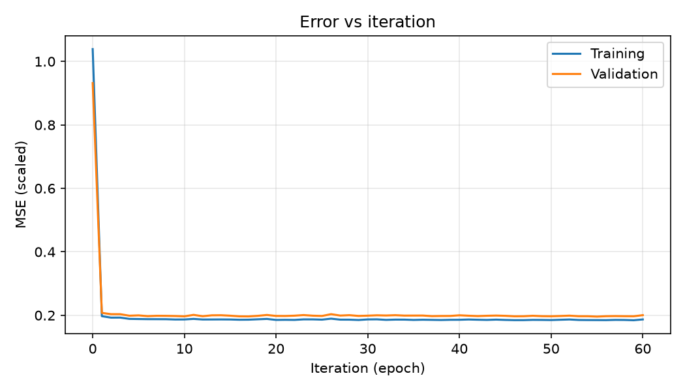
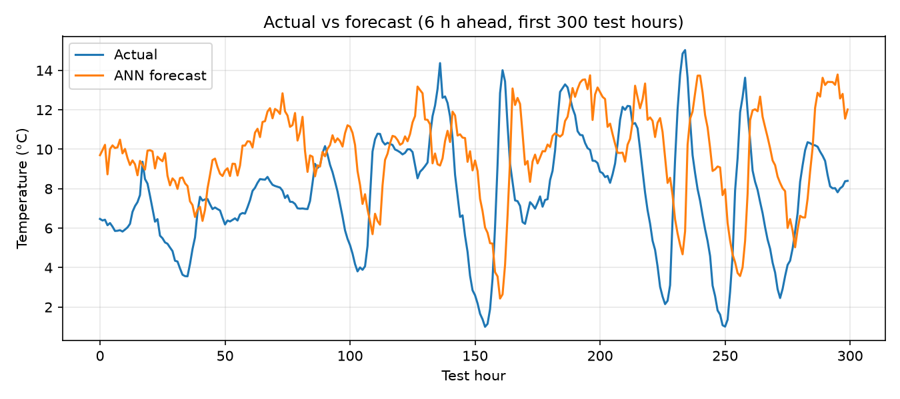

# ANN with Backpropagation for Weather Forecasting

Assignment for **Artificial Neural Networks** (BSCS 7th Semester), Institute of Computing, Kohat University of Science & Technology.

**Muhammad Wasiq Tanveer** · CS120232036

A feed-forward neural network, written from scratch in NumPy, that forecasts the air temperature **6 hours ahead** from four current weather readings. It is trained with backpropagation and mini-batch gradient descent with momentum.

## Data

[`weather_4params.csv`](weather_4params.csv) contains hourly readings from the Jena Climate dataset (Max Planck Institute for Biogeochemistry, 2009 to 2016), reduced to four columns:

| Column | Meaning |
|---|---|
| `pressure_mbar` | air pressure (mbar) |
| `temp_c` | air temperature (°C) |
| `humidity_pct` | relative humidity (%) |
| `wind_speed_ms` | wind speed (m/s) |

Original source: https://storage.googleapis.com/tensorflow/tf-keras-datasets/jena_climate_2009_2016.csv.zip

## Network

```
4 inputs → 16 (tanh) → 8 (tanh) → 1 (linear)
```

Learning rate 0.01, momentum 0.9, batch size 128, 60 epochs. Split by time: 70% train, 15% validation, 15% test.

## Results (test set)

| Model | RMSE (°C) | MAE (°C) | R² |
|---|---|---|---|
| ANN (backprop) | 3.51 | 2.69 | 0.797 |
| Baseline: "temperature stays the same" | 4.02 | 3.01 | 0.734 |




## Run

```
pip install numpy pandas matplotlib
python forecast_bp.py
```

Plots and `results.txt` are written to `outputs/`. The full report is [`ANN_Assignment_CS120232036.pdf`](ANN_Assignment_CS120232036.pdf).
