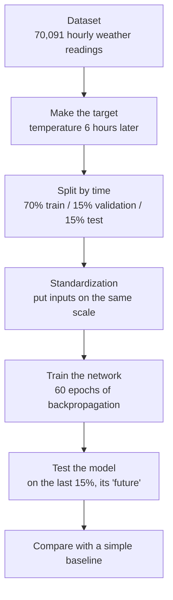
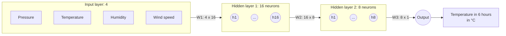
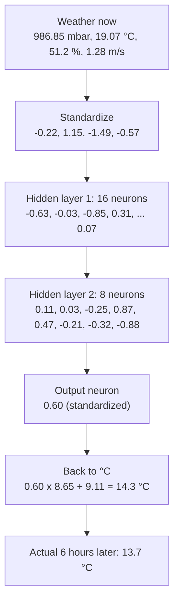
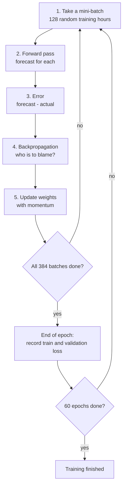
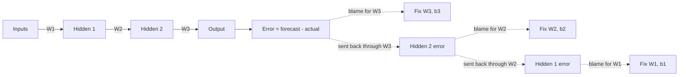
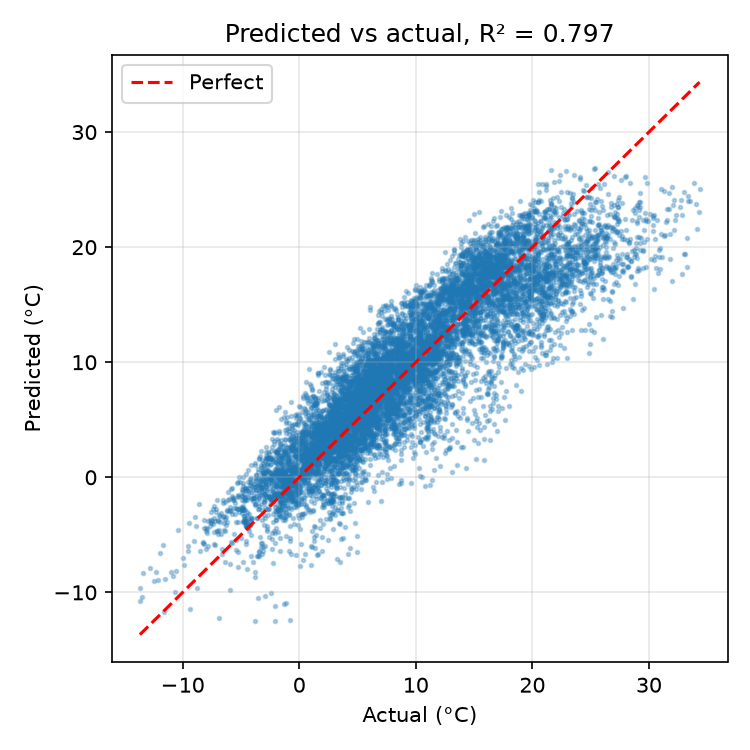
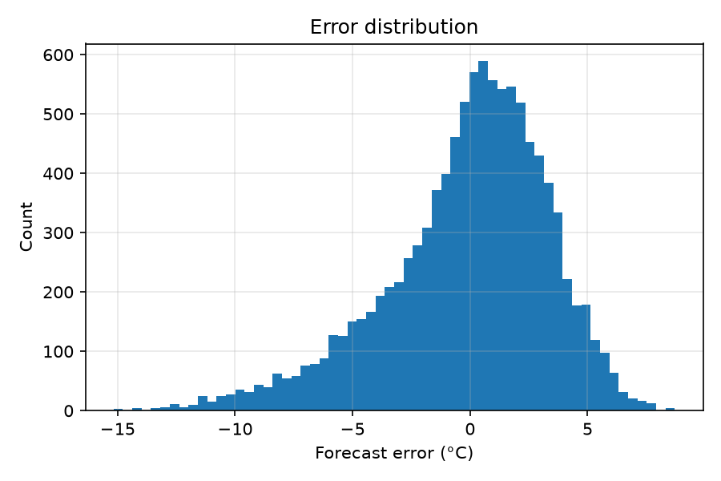

# Weather Forecasting with a Neural Network (Backpropagation from scratch)

A small neural network, written in plain **NumPy**, that forecasts the air temperature **6 hours ahead** from 4 weather readings taken right now.

No deep-learning library is used. Every step (forward pass, loss, backpropagation, weight updates) is written by hand in one file, [`forecast_bp.py`](forecast_bp.py), and this README explains each of them in plain English.

Assignment for **Artificial Neural Networks**, BSCS 7th Semester, Institute of Computing, Kohat University of Science & Technology.
**Muhammad Wasiq Tanveer** · CS120232036 · full report: [`ANN_Assignment_CS120232036.pdf`](ANN_Assignment_CS120232036.pdf)

---

## 1. The big picture



The model learns from years of past weather where we already know what the temperature did 6 hours later. The last 15% of the data (the most recent period) is hidden during training and used at the end to check whether it can really forecast.

---

## 2. The network: 4 inputs → 16 → 8 → 1 output



- **Input layer:** the 4 numbers describing the weather right now.
- **Hidden layer 1:** 16 small "detectors". Each one looks at all 4 inputs and picks up some pattern, for example "dry air and falling pressure".
- **Hidden layer 2:** 8 neurons that combine those patterns into bigger ones.
- **Output neuron:** combines the 8 values into one number, the forecast temperature.

Two hidden layers make this a **multi-layer** network. That is exactly why backpropagation is needed: the error has to be passed back through more than one layer.

### Weights and biases

- A **weight** is the strength of one connection. A big weight means "this input matters a lot to this neuron". Learning means finding good weights.
- A **bias** is a neuron's own starting push up or down, before it looks at any input.

### How many numbers does it learn?

| | Size | Count |
|---|---|---:|
| `W1` | 4 × 16 | 64 |
| `b1` | 16 | 16 |
| `W2` | 16 × 8 | 128 |
| `b2` | 8 | 8 |
| `W3` | 8 × 1 | 8 |
| `b3` | 1 | 1 |
| **Total** | | **225** |

At the start they are random. Training improves them.

---

## 3. The data

**Jena Climate dataset:** recorded by the Max Planck Institute for Biogeochemistry at a weather station in Jena, Germany, from 2009 to 2016. The original has 14 measurements every 10 minutes (about 420,000 rows).

Original source: https://storage.googleapis.com/tensorflow/tf-keras-datasets/jena_climate_2009_2016.csv.zip

To keep things simple, [`weather_4params.csv`](weather_4params.csv) keeps **one reading per hour** (70,091 rows) and **4 columns**:

| Column | Used as | Meaning |
|---|---|---|
| `pressure_mbar` | input | air pressure (mbar) |
| `temp_c` | input | air temperature now (°C) |
| `humidity_pct` | input | relative humidity (%) |
| `wind_speed_ms` | input | wind speed (m/s) |
| `temp_c` 6 hours later | **answer** | what we want to forecast |

Why only 4? They are easy to understand, they are the readings a basic home weather station gives you, and the code stays short.

```text
datetime              pressure  temp   humidity  wind
01.01.2009 01:00:00    996.50   -8.05    94.40   0.21
01.01.2009 02:00:00    996.62   -8.88    93.20   0.25
01.01.2009 03:00:00    996.84   -8.81    93.50   0.18
```

---

## 4. Preparing the data

### Making the answer column

There is no "forecast" column in the file. We make one by looking 6 rows (6 hours) ahead:

```python
HORIZON = 6
feat = df[["pressure_mbar", "temp_c", "humidity_pct", "wind_speed_ms"]].copy()
target = df["temp_c"].shift(-HORIZON)
```

`shift(-6)` moves the temperature column up by 6 rows, so each row now has "the weather now" next to "the temperature 6 hours later". This single line is what turns ordinary data into a **forecasting** problem. The last 6 rows have no future, so they are dropped.

### Split: by time, not shuffled

```python
i1, i2 = int(0.70 * n), int(0.85 * n)
Xtr, Xva, Xte = X[:i1], X[i1:i2], X[i2:]
```

- **49,059 hours** for training (the model learns from them).
- **10,513 hours** for validation (checked after every epoch to watch for overfitting).
- **10,513 hours** for testing (the most recent period, hidden until the end).

The rows are **not shuffled**. In forecasting the test set must come *after* the training data in time. Otherwise the model would be "forecasting" days that sit between days it already studied, which is cheating.

### Standardization

Pressure is around 989 while wind speed is around 2, so the big numbers would dominate. Standardizing rescales every column so its average becomes 0 and a typical spread becomes 1:

```text
new value = (value - average) / spread
```

```python
mu, sd = Xtr.mean(0), Xtr.std(0) + 1e-8
Xtr, Xva, Xte = [(a - mu) / sd for a in (Xtr, Xva, Xte)]
```

| | Pressure | Temperature | Humidity | Wind |
|---|---:|---:|---:|---:|
| average | 988.66 | 9.11 | 75.90 | 2.15 |
| spread | 8.30 | 8.66 | 16.56 | 1.53 |

So a temperature of 19.07 °C becomes `(19.07 - 9.11) / 8.66 = 1.15`, which means "clearly warmer than average". The answer column is standardized the same way, and the network's output is converted back to °C at the end.

> **No peeking:** the averages and spreads come from the **training data only**, then are reused on validation and test data. If future data influenced them, the test would no longer be fair.

---

## 5. One reading's journey

A real reading from the test set: **pressure 986.85, temperature 19.07 °C, humidity 51.2%, wind 1.28 m/s**. These numbers come from a real run of the code.



It is warm and dry right now, and the network forecasts that it will cool down by about 5 °C. The real temperature dropped to 13.7 °C, so the forecast was off by only 0.6 °C. Notice that each neuron reacts differently to the same reading: in layer 2, neuron 4 fires strongly (+0.87) and neuron 8 strongly the other way (-0.88).

---

## 6. Forward propagation (making a guess)

"Forward" means pushing the numbers from the inputs, through the hidden layers, to the output:

```python
def forward(x):
    acts = [x]
    for i in range(len(W)):
        z = acts[-1] @ W[i] + b[i]
        acts.append(np.tanh(z) if i < len(W) - 1 else z)   # linear output (regression)
    return acts
```

**For each layer:** `acts[-1] @ W[i]` is **matrix multiplication**. For every neuron it multiplies each incoming value by its weight and adds them up:

```text
score = pressure x w1 + temperature x w2 + humidity x w3 + wind x w4 + bias
```

Then the hidden layers apply **tanh**. The output layer does **not**, because a temperature can be any number (we are doing *regression*, not yes/no classification).

`acts` keeps every layer's values in a list, because backpropagation needs them later.

**How the sizes work out** for one mini-batch of 128 readings:

```text
x         @   W1      =   hidden 1
(128 × 4)    (4 × 16)    (128 × 16)

hidden 1  @   W2      =   hidden 2
(128 × 16)   (16 × 8)    (128 × 8)

hidden 2  @   W3      =   output
(128 × 8)    (8 × 1)     (128 × 1)     one forecast per reading
```

### tanh

tanh squashes any number into the range **-1 to +1**:

| score | tanh |
|---|---|
| -2 | -0.96 |
| -1 | -0.76 |
| 0 | 0.00 |
| +1 | +0.76 |
| +2 | +0.96 |

It is like the sigmoid but centred on zero, which suits standardized data (also centred on zero). It bends the numbers in a non-linear way; without that, stacking layers would be no better than one layer.

---

## 7. Loss (how wrong was the guess?)

The **loss** is one number that says how wrong the model is overall. Here it is the **mean squared error (MSE)**: take each error, square it, and average:

| Forecast | Actual | Error | Squared |
|---|---|---|---|
| 14 °C | 13 °C | 1 | 1 |
| 16 °C | 13 °C | 3 | 9 |
| 19 °C | 13 °C | 6 | 36 |

Squaring makes all errors positive and punishes big misses much more than small ones. During training the loss is measured on the standardized values, so it starts around **1.04** (random guessing) and the goal is to push it down.

---

## 8. Learning: backpropagation and gradient descent

### The training loop



One full pass over all 49,059 training hours is an **epoch**. Each epoch is cut into **384 mini-batches** of 128 hours, and the weights are updated after every batch. 60 epochs × 384 = **23,040 updates** in total.

### Backpropagation in plain English

The forecast came from a chain: inputs → hidden 1 → hidden 2 → output. If the output was wrong, some of the blame belongs to the last layer's connections, some to hidden layer 2, and some to hidden layer 1.

Backpropagation works like finding out why a group project went badly:

1. See how wrong the final result was.
2. Ask the last step: "how much of this is your fault?"
3. Pass the leftover blame back one step, then another.
4. Everyone adjusts a little, in proportion to their blame.



### The code, line by line

```python
delta = (acts[-1] - target_s) / m
```
**The output's error:** forecast minus truth, divided by the batch size `m` so it becomes an average. If the network said 14 °C and the truth was 13 °C, the error is positive: "you were too high".

```python
for i in reversed(range(len(W))):
```
**Go backwards:** layer 3, then 2, then 1. That is the "back" in backpropagation.

```python
    gW[i] = acts[i].T @ delta
    gb[i] = delta.sum(0, keepdims=True)
```
**Blame for this layer's weights:** "how big was the input coming into this connection" times "how big was the error here". A connection that carried a large value into a large error gets a lot of blame. The result has the same size as the weights, e.g. for `W3`: (8 × 128) @ (128 × 1) = (8 × 1).

```python
    if i > 0:
        delta = (delta @ W[i].T) * (1 - acts[i] ** 2)
```
**Send the error back one layer.** Each neuron in the previous layer gets a share of the error (`delta @ W[i].T`): the bigger its connection, the more blame. The part `1 - acts[i] ** 2` is **tanh's slope**: a neuron that is already saturated near -1 or +1 barely reacts to changes, so it gets less blame.

### Gradient descent with momentum

The blame calculated above is the **gradient**: it points in the direction that makes the loss bigger. So we step the **opposite** way:

```python
vW[i] = MOM * vW[i] - LR * gW[i]
W[i] += vW[i]
```

```text
velocity   = 0.9 × previous velocity  -  0.01 × gradient
new weight = old weight + velocity
```

Picture rolling a ball down a foggy hill. Plain gradient descent takes a small step downhill each time. **Momentum** lets the ball keep 90% of its previous speed, so it rolls through small bumps and moves faster along long slopes. With noisy mini-batches, this makes training smoother.

- **Learning rate** `LR = 0.01`: the size of each step.
- **Momentum** `MOM = 0.9`: how much of the previous step is kept.

### Starting weights

```python
W = [np.random.randn(a, b) * np.sqrt(2.0 / (a + b)) ...]
```

Random, but scaled by the layer sizes (**Xavier initialization**). If the starting weights were too big, tanh would be saturated from the start and learning would stall. If they were too small, the signal would fade away layer by layer.

---

## 9. Evaluation

### Error vs iteration


The loss falls from **1.04 to 0.20 during the first epoch**, then improves only slightly. The validation curve stays right next to the training curve, so the network is **not overfitting**: it does as well on unseen hours as on the ones it trained on.

### Is it actually useful? The baseline

A forecast is only impressive if it beats something simple. The simplest forecast is: **"in 6 hours it will be the same temperature as now."** Results on the 10,513 test hours:

| Model | MSE | RMSE (°C) | MAE (°C) | R² |
|---|---:|---:|---:|---:|
| **ANN (backprop)** | **12.30** | **3.51** | **2.69** | **0.797** |
| Baseline: "same as now" | 16.12 | 4.02 | 3.01 | 0.734 |

- **MSE:** the average squared error, the same thing the network minimises. Lower is better.
- **RMSE:** square root of MSE, back in °C. Roughly the size of a typical error.
- **MAE:** the average error in °C, whether too high or too low.
- **R²:** how much of the temperature's up-and-down the model explains. 1 is perfect, 0 is no better than always guessing the average.

The ANN wins on every measure. Half of its forecasts are within **2.2 °C** of the truth, and 64% are within 3 °C. So it has learned how pressure, humidity and wind tell you where the temperature is heading, not just copied the current value.

### Forecast vs reality


The forecast follows the daily rise and fall of the temperature. It reacts a little late to sudden drops and peaks, which is expected: it only sees the current hour and has to guess 6 hours ahead.



Each dot is one test hour. Most lie close to the red line where forecast = actual, across the whole range from about -14 °C to 34 °C.



The errors are centred near zero and roughly bell-shaped, so the network does not consistently forecast too high or too low.

---

## 10. How to run

```bash
pip install numpy pandas matplotlib
python forecast_bp.py
```

You need Python 3. The random seed is fixed, so you get the same numbers every time.

**Example output:**

```text
epoch   0  train MSE 1.0389  val MSE 0.9318
epoch   1  train MSE 0.1971  val MSE 0.2076
epoch  11  train MSE 0.1886  val MSE 0.2013
  ...
epoch  60  train MSE 0.1870  val MSE 0.2004

Samples: train 49059, val 10513, test 10513
Inputs (4): pressure_mbar, temp_c, humidity_pct, wind_speed_ms
Architecture: [4, 16, 8, 1], tanh hidden, linear output, lr=0.01, momentum=0.9, batch=128, epochs=60
Forecast horizon: 6 hours

Model                            MSE    RMSE     MAE      R2
ANN (backprop)                12.297   3.507   2.692   0.797
Baseline (same as now)        16.117   4.015   3.013   0.734
```

The four plots and `results.txt` are saved to `outputs/`.

## Project structure

```text
.
├── forecast_bp.py                      # all the code
├── weather_4params.csv                 # the data (hourly, 4 columns)
├── outputs/                            # plots, results.txt, console.txt
├── ANN_Assignment_CS120232036.pdf      # the submitted report
├── ANN_Assignment_CS120232036.docx     # same report, Word version
└── README.md
```

---

## 11. Limitations

- The network only sees **one moment**. It cannot tell whether the temperature is rising or falling, which is why it reacts late to sudden changes.
- It does not know the **time of day** or **season**, even though temperature follows strong daily and yearly cycles.
- One weather station in Germany, so it should not be assumed to work for other climates.
- A single train/validation/test split.

## 12. Possible improvements

- Feed in the **last few hours** of readings, not just the current one, so the network can see trends.
- Add **hour of day** and **day of year** as inputs.
- Use **early stopping**: keep the weights from the epoch with the lowest validation loss.
- Try **ReLU** in the hidden layers, or the **Adam** optimizer instead of momentum.
- Try a **recurrent network (LSTM)**, which is built for sequences like this.
